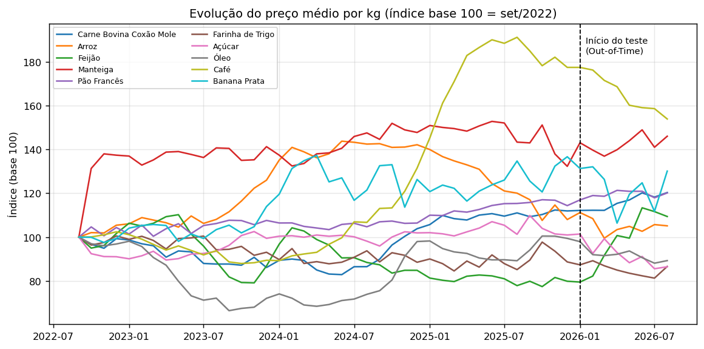
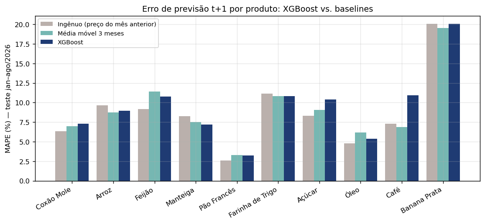
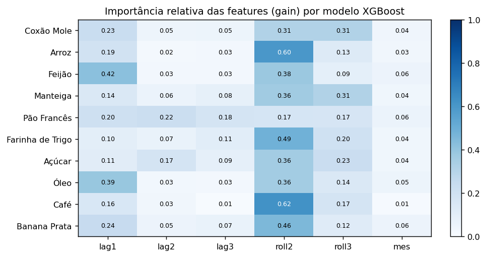
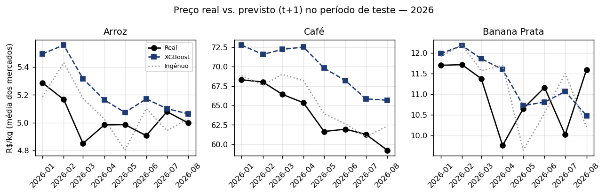
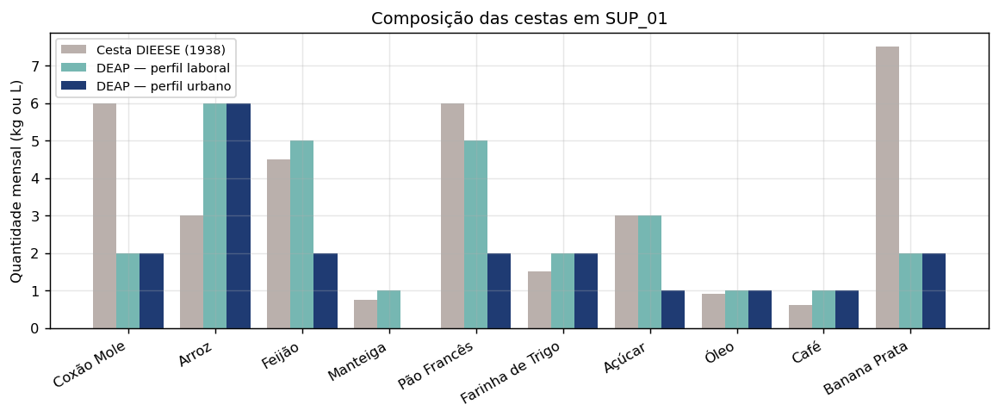
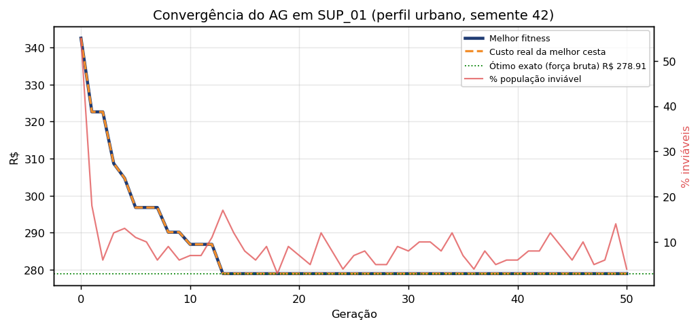
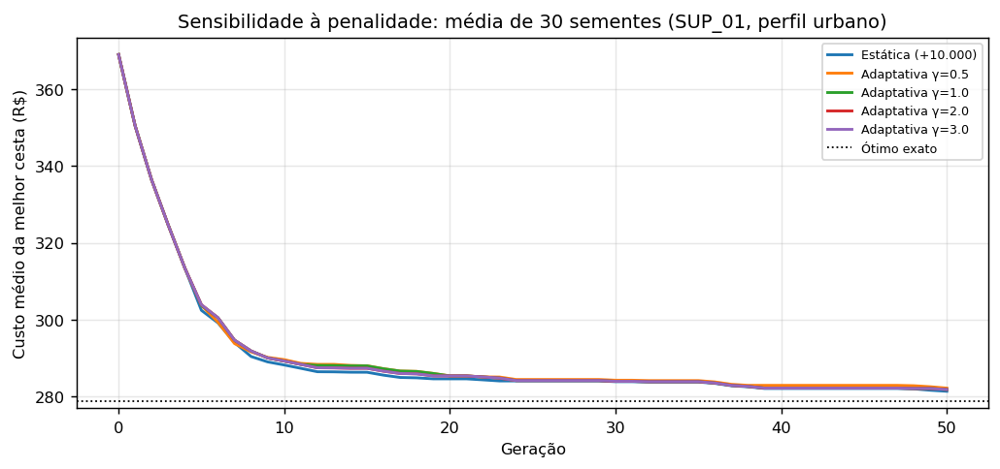
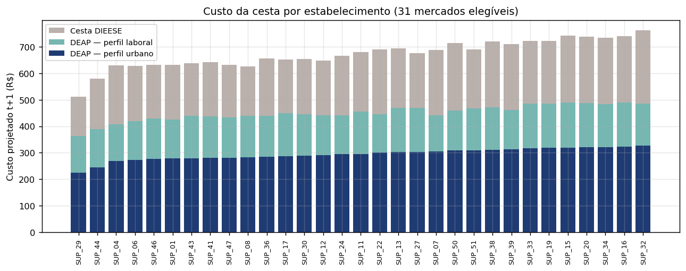

# Relatório de Atividade de Extensão — MOCaP / CestaGen

**Título:** MOCaP: Modelo Computacional para Previsão e Otimização Nutricional de Preços da Cesta Básica no Varejo  
**Instituição:** Pontifícia Universidade Católica de Campinas (PUC-Campinas)  
**Curso:** Engenharia de Computação — Disciplina de Aprendizado de Máquina (Atividade de Extensão)  
**Data:** Novembro de 2026  

> **Integrantes do Grupo:** *[Preencher com os nomes completos e RAs dos alunos]*  
> **Professor(a) Responsável:** *[Preencher com o nome do(a) professor(a)]*  

---

## Resumo Executivo

Este relatório apresenta o desenvolvimento, a fundamentação metodológica e a validação experimental do **MOCaP (Modelo Computacional para Otimização e Análise de Preços no Varejo)**, também denominado **CestaGen**. Como atividade de extensão voltada ao apoio à decisão de consumo das famílias diante da inflação de alimentos, o projeto explora uma base real com **46.264 coletas de preços** do Índice da Cesta Básica (ICB), abrangendo **51 estabelecimentos** ao longo de **48 meses** (setembro de 2022 a agosto de 2026).

Estruturamos a investigação em torno de **duas questões de pesquisa complementares** que conectam aprendizado supervisionado e otimização heurística em um pipeline único ponta a ponta, disponibilizado ao usuário final por meio de um **dashboard interativo em Streamlit (`app.py`)**:

1. **Questão 1 (Predição Temporal):** É possível projetar os preços do mês seguinte ($t+1$) dos 10 itens da cesta básica por estabelecimento, a partir de séries históricas curtas e com falhas de coleta, mantendo rigor na prevenção de *data leakage*?
2. **Questão 2 (Otimização Nutricional-Financeira):** A partir das projeções de preços para $t+1$, um Algoritmo Genético com penalidade adaptativa consegue compor uma cesta básica culturalmente realista, nutricionalmente válida e substancialmente mais econômica que a cesta oficial de referência do DIEESE?

Os resultados demonstram que o pipeline **ETL → XGBoost → Bridge → DEAP** atende aos objetivos propostos: os modelos preditivos alcançaram **RMSE menor que o modelo ingênuo em 8 de 10 produtos** (MAPE médio de **9,50%**, chegando a **3,25%** no Pão Francês), enquanto o otimizador genético atingiu o **ótimo global exato em 31 de 31 estabelecimentos elegíveis** no perfil urbano padrão, gerando uma economia média de **56,17%** frente ao custo da cesta DIEESE (ou **35,04%** quando isolado o efeito puro da substituição de itens sob a mesma exigência calórica).

---

## 1. Contextualização e Base de Dados

### 1.1 Fonte de Dados e Dimensões

Utilizamos a planilha `ICB_DADOS_2026.xlsx` (aba `ACUMUL_DESAGREG`), que reúne registros históricos reais de preços por quilo/litro (**PPK**) coletados no varejo alimentício:

| Dimensão da Base | Valor Observado |
|---|---|
| Total de registros brutos | 46.264 linhas |
| Período de coleta | Setembro/2022 a Agosto/2026 (48 meses) |
| Estabelecimentos monitorados | 51 (supermercados, atacarejos e lojas de conveniência) |
| Produtos distintos na base bruta | 30 itens |
| Produtos selecionados (cesta nutricional) | 10 itens (34.305 registros) |
| Outliers extremos removidos (`PPK < R$ 1,00`) | 3 registros (erros de digitação, ex.: R$ 0,10/kg) |
| Tabela pivotada `(Mes_Ano_Data, Estab) × Produto` | 1.281 linhas × 10 colunas (12.810 células) |
| Valores ausentes tratados pela interpolação | 579 células (4,52%) |
| Estabelecimentos elegíveis para projeção ($\ge 3$ meses) | 31 estabelecimentos (mediana de 34 meses/estab.) |

A Figura 1 ilustra a dinâmica heterogênea dos preços médios entre 2022 e 2026 (em índice base 100 = set/2022): itens como **Café (+53,9%)**, **Manteiga (+46,1%)** e **Banana Prata (+30,1%)** apresentaram forte valorização ou volatilidade sazonal, enquanto **Açúcar (-13,6%)**, **Farinha de Trigo (-13,4%)** e **Óleo (-10,7%)** recuaram no acumulado.

### 1.2 Pipeline de ETL e Prevenção de *Data Leakage*

O saneamento dos dados (`carregar_dados_icb` em `etl_genetico.py`) foi projetado com duas salvaguardas críticas:

1. **Interpolação em três camadas isolada por estabelecimento:** Como os dados estão empilhados em um `MultiIndex` `(Mes_Ano_Data, Estab)`, aplicar `ffill().bfill()` diretamente sobre o DataFrame faria com que o último preço de um mercado vazasse para o primeiro mês do mercado seguinte. Por isso, executamos:
   - *Camada 1:* `ffill().bfill()` agrupado estritamente por `Estab`;
   - *Camada 2:* Para ausências estruturais (mercados que nunca comercializaram determinado item, como o Pão Francês em lojas sem padaria), preenchimento pela média de mercado daquele mesmo mês (`Mes_Ano_Data`);
   - *Camada 3:* *Fallback* residual de segurança (`bfill().ffill()`), garantindo **zero `NaN`** na saída.
2. **Threshold de qualidade por estabelecimento (`identificar_estabelecimentos_qualificados`):** Antes da interpolação, mapeamos a taxa de ausência histórica de cada par `(Estab, Produto)`. Estabelecimentos com mais de **50% de meses ausentes** em um produto são excluídos do treino e teste daquele item, evitando que séries majoritariamente sintéticas contaminem as árvores de decisão (por exemplo, apenas **39 de 51** mercados possuem histórico real consistente para Pão Francês, e **47 de 51** para Carne Bovina e Farinha de Trigo).

---

## 2. Questão 1 — Previsão de Preços Futuros ($t+1$) por Produto e Estabelecimento

### 2.1 Questão
É possível prever o preço por quilo/litro do mês seguinte ($t+1$) para os 10 produtos da cesta básica em diferentes estabelecimentos varejistas usando exclusivamente variáveis históricas defasadas e sazonalidade mensal, evitando vazamento de dados temporais e entre mercados?

### 2.2 Objetivo e Motivação
**Objetivo:** Construir e validar um conjunto de 10 modelos dedicados de aprendizado supervisionado capazes de antecipar preços de varejo para o horizonte $t+1$.  
**Motivação e aplicação direta:** Em um cenário de inflação desigual entre categorias e estabelecimentos, o consumidor toma decisões com base no preço passado. Dispor de projeções confiáveis para o próximo mês permite alimentar diretamente um sistema de planejamento de compras (Questão 2) e alertar sobre itens em trajetória de alta.

### 2.3 Método

#### Escolha do Algoritmo: `XGBRegressor` (XGBoost)
Optamos por treinar um modelo **XGBoost** (`XGBRegressor`) dedicado por produto, com regularização explícita para séries curtas (`n_estimators=100`, `max_depth=3`, `learning_rate=0.05`, `subsample=0.8`, `colsample_bytree=0.8`, `random_state=42`). A escolha justifica-se por: (i) invariância a escalas heterogêneas (de R$ 4/kg no Açúcar a R$ 71/kg na Manteiga); (ii) captura de relações não-lineares e interações entre tendência recente e sazonalidade; e (iii) interpretabilidade via importância de *features* (*gain*).

#### Engenharia de *Features* sem *Data Leakage*
Para cada produto $p$, geramos 6 variáveis explicativas agrupadas estritamente por `Estab` (`criar_features_temporais` em `predicao.py`):

$$X_t^{(p)} = \left[\, PPK_{t-1}^{(p)},\; PPK_{t-2}^{(p)},\; PPK_{t-3}^{(p)},\; \overline{PPK}_{[t-1,t-2]}^{(p)},\; \overline{PPK}_{[t-1,t-2,t-3]}^{(p)},\; \text{mês}_t \,\right]$$

As médias móveis `roll2` e `roll3` são calculadas sobre `lag1` (valores até $t-1$), nunca sobre o alvo contemporâneo $t$. Uma auditoria automática em `predicao.py` verifica que a primeira data de todos os 51 estabelecimentos possui `NaN` nos lags, comprovando zero vazamento entre mercados.

#### Protocolo de Avaliação (*Out-of-Time* + *Baselines*)
Proibimos o uso de `train_test_split` aleatório. Adotamos partição cronológica estrita com corte em `2026-01-01`:
- **Treino:** Set/2022 a Dez/2025 (**991** registros após remoção dos 3 primeiros meses de lag por mercado);
- **Teste (*Out-of-Time*):** Jan/2026 a Ago/2026 (**173** registros, sendo 146 para Pão Francês após o filtro de qualidade).

Avaliamos os modelos por **RMSE** (erro quadrático médio em R$/kg) e **MAPE** (erro percentual absoluto médio), comparando o XGBoost contra dois *baselines* clássicos de séries temporais:
1. **Modelo Ingênuo (Persistência):** $\hat{y}_t = PPK_{t-1}$ (preço do mês anterior);
2. **Média Móvel de 3 meses (MM3):** $\hat{y}_t = \overline{PPK}_{[t-1,t-2,t-3]}$.

Além disso, realizamos duas verificações adicionais de rigor: (a) medição das métricas **apenas sobre coletas reais observadas** (excluindo os 4,3% de pontos interpolados no conjunto de teste), e (b) teste de uma variante do XGBoost treinada sobre **retornos relativos** ($y_t / y_{t-1} - 1$) para investigar a limitação de extrapolação em árvores de decisão.

### 2.4 Resultados e Discussão (Questão 1)

A Tabela 1 consolida o desempenho *Out-of-Time* (jan–ago/2026) dos 10 modelos frente aos *baselines*.

| Produto | Preço Médio (R$) | RMSE XGBoost (R$) | RMSE Ingênuo (R$) | MAPE XGBoost (%) | MAPE Ingênuo (%) | MAPE MM3 (%) | Mercados Usados |
|---|---|---|---|---|---|---|---|
| **Pão Francês** | 18,51 | **1,39** | 1,49 | 3,25% | **2,61%** | 3,30% | 39 / 51 |
| **Óleo** | 9,06 | **0,66** | 0,69 | 5,36% | **4,79%** | 6,18% | 51 / 51 |
| **Manteiga** | 70,99 | **7,01** | 8,37 | **7,18%** | 8,25% | 7,50% | 51 / 51 |
| **Carne Bovina Coxão Mole** | 52,10 | **5,24** | 5,67 | 7,28% | **6,36%** | 6,97% | 47 / 51 |
| **Arroz** | 5,03 | **0,56** | 0,63 | 8,97% | 9,66% | **8,73%** | 51 / 51 |
| **Açúcar** | 4,29 | **0,55** | 0,60 | 10,37% | **8,30%** | 9,06% | 50 / 51 |
| **Feijão** | 9,14 | 1,26 | **1,10** | 10,76% | **9,18%** | 11,42% | 51 / 51 |
| **Farinha de Trigo** | 5,60 | **0,75** | 0,89 | 10,84% | 11,16% | **10,83%** | 47 / 51 |
| **Café** | 63,76 | 8,01 | **5,94** | 10,92% | 7,28% | **6,85%** | 51 / 51 |
| **Banana Prata** | 11,00 | **2,45** | 2,96 | 20,05% | 20,07% | **19,54%** | 50 / 51 |
| **Média (10 produtos)** | — | — | — | **9,50%** | **8,77%** | **9,04%** | — |

A análise conjunta da Tabela 1 e das Figuras 2, 3 e 4 revela quatro achados importantes:

1. **Redução de erros extremos (RMSE vs. MAPE):** O XGBoost superou o modelo ingênuo em **RMSE em 8 de 10 produtos** (por exemplo, Manteiga caiu de R$ 8,37 para R$ 7,01; Banana Prata de R$ 2,96 para R$ 2,45; Carne Bovina de R$ 5,67 para R$ 5,24), demonstrando que a suavização pelas médias móveis (`roll2` responde por **41,1%** do ganho médio e `lag1` por **22,0%**, conforme a Figura 3) protege contra picos pontuais de erro. Em termos de MAPE médio global, porém, a persistência (`8,77%`) foi ligeiramente inferior ao XGBoost (`9,50%`), vencendo em 6 dos 10 itens.
2. **Impacto do *Threshold* de Qualidade no Pão Francês:** Na modelagem preliminar sem filtro de qualidade, o Pão Francês apresentava MAPE de **16,47%**, pois 12 mercados sem padaria geravam séries sintéticas interpoladas. Ao filtrar apenas os 39 mercados com ≤ 50% de ausência, o MAPE caiu para **3,25%**.
3. **Limitação de extrapolação no Café e ganho com retornos relativos:** Como visto na Figura 4, o Café iniciou em 2026 uma trajetória de queda após atingir pico histórico em 2025. Como árvores de decisão preveem médias das folhas observadas no treino, o XGBoost em nível superestimou o preço do Café em 2026 (MAPE de 10,92% vs. 7,28% ingênuo). Ao testar uma variante do XGBoost sobre **retornos relativos** ($y_t / y_{t-1} - 1$), o MAPE do Café caiu para **7,64%** e o MAPE médio global melhorou de **9,50% para 9,19%**.
4. **Validação sem interpolação e volatilidade hortifruti:** Restringindo o teste exclusivamente aos **95,7% de registros efetivamente coletados** (sem interpolação no mês $t$), as conclusões mantiveram-se idênticas (MAPE médio de **9,69%** no XGBoost vs. **9,11%** no ingênuo; RMSE melhor em 8/10 produtos). Já a **Banana Prata** manteve MAPE próximo de 20% em todos os modelos por ser um item hortifruti perecível sujeito a choques climáticos exógenos não capturados por séries puramente autorregressivas.

### 2.5 Conclusão (Questão 1)
A Questão 1 foi respondida positivamente com ressalvas metodológicas bem caracterizadas: o pipeline entrega projeções consistentes para $t+1$ (MAPE < 11% em 9 dos 10 produtos e redução de RMSE em 8/10 frente à persistência), garantindo rigor temporal (*Out-of-Time*) e ausência de *data leakage*. Como achado científico relevante para a arguição, identificamos que a modelagem em nível com árvores sofre viés em regimes de reversão de tendência (caso do Café), indicando a modelagem de retornos relativos ou inclusão de variáveis exógenas como evolução natural.

---

## 3. Questão 2 — Otimização Nutricional e Orçamentária da Cesta Básica

### 3.1 Questão
Utilizando os preços projetados para $t+1$ via XGBoost, é possível formular e resolver um problema de otimização combinatória via Algoritmo Genético (DEAP) com penalidade adaptativa progressiva que reduza expressivamente o custo mensal da cesta básica em comparação à cesta padrão do DIEESE, preservando viabilidade nutricional e realismo alimentar?

### 3.2 Objetivo e Motivação
**Objetivo:** Integrar as projeções $\hat{y}_{t+1}$ de um estabelecimento (função `bridge_precos_deap`) a um Algoritmo Genético capaz de encontrar a combinação inteira de quantidades $[q_1, \dots, q_{10}]$ de menor custo financeiro que respeite simultaneamente metas calóricas, proteicas, de qualidade nutricional e de hábito alimentar brasileiro.  
**Motivação e fundamentação das metas:** A cesta básica oficial brasileira (**`CESTA_PADRAO_DIEESE`**, Região Sudeste/SP, **33,75 kg/mês**) foi instituída pelo **Decreto-Lei nº 399/1938**, dimensionada para um trabalhador adulto em atividade física braçal intensa (**93.360 kcal/mês**, ~3.112 kcal/dia, e **3.792 g proteína/mês**). Já as metas padrão do nosso sistema (**60.000 kcal/mês** e **1.500 g proteína/mês**) fundamentam-se no Valor Diário de Referência (VDR) da **ANVISA (RDC nº 429/2020)** e nas recomendações da **OMS** para um adulto médio urbano (2.000 kcal/dia × 30 dias e 50 g proteína/dia × 30 dias). Além disso, nosso dashboard permite alternar entre o perfil **Urbano Padrão (ANVISA/OMS)** e o perfil **Alta Demanda / Laboral (93.360 kcal/mês e 2.250 g proteína/mês)** para isolar o ganho puro de otimização.

### 3.3 Método

#### Formulação Matemática e Correções de Modelagem
Os valores nutricionais dos 10 itens foram padronizados em **peso seco pela Tabela TACO** (`nutricao_mock.py`), corrigindo a inconsistência inicial em que o Arroz figurava como cozido (`1.300 kcal/kg` em vez de `3.580 kcal/kg` e `72 g prot/kg`, coerente com o preço em grão seco coletado no ICB). O problema é definido por:

$$\min_{\mathbf{q}} \sum_{i=1}^{10} q_i \cdot \hat{p}_i \quad \text{sujeito a:} \quad q_i \in [\text{min}_i, \text{max}_i] \cap \mathbb{Z}$$

Onde os limites individuais (`LIMITES_PRODUTOS`, totalizando **294.000 combinações** no espaço de busca) impõem pisos culturais mínimos (ex.: Carne 2..8 kg, Arroz 2..6 kg, Feijão 1..5 kg, Pão 2..6 kg, Café 1..2 kg, Banana 2..8 kg, Açúcar 1..3 kg, Óleo 1..2 L, Manteiga 0..1 kg) e evitam cestas degeneradas. Além disso, `avaliar_cesta()` exige quatro regras simultâneas:
1. Calorias totais $\ge \text{meta\_calorias}$;
2. Proteínas totais $\ge \text{meta\_proteinas}$;
3. **Teto de calorias vazias:** $(\text{cal}_{\text{Açúcar}} + \text{cal}_{\text{Óleo}}) \le 25\%$ das calorias totais;
4. **Proporção cultural:** $\text{kg}_{\text{Arroz}} \ge 0{,}5 \times \text{kg}_{\text{Feijão}}$.

#### Algoritmo Genético e Penalidade Adaptativa Progressiva (Fase 7.3)
Implementamos o otimizador em **DEAP** (`otimizar_cesta_genetica` em `etl_genetico.py`) com inicialização heterogênea (`initIterate`), cruzamento `cxTwoPoint` ($p_c = 0{,}7$), mutação `mutUniformInt` respeitando `LOW_BOUNDS`/`UP_BOUNDS` ($p_m = 0{,}2$, `indpb = 0.2`), seleção por torneio (`tournsize = 3`) e elitismo (`HallOfFame(1)`). Para evitar convergência prematura para regiões inviáveis ou excessivamente conservadoras, aplicamos a penalidade adaptativa progressiva:

$$P(\mathbf{q}, g) = \left[ 500 + 9.500 \cdot \left(\frac{g}{N_{\text{gen}}}\right)^\gamma \right] \times \left(1 + \Delta_{\text{nutricional}}(\mathbf{q})\right) \cdot \mathbb{1}[\text{violação}]$$

Apenas indivíduos inviáveis ($\Delta_{\text{nutricional}} > 0$) têm seu fitness reavaliado a cada geração, economizando processamento.

#### Critérios de Avaliação
Validamos o Algoritmo Genético contra:
1. **Ótimo Global Exato (Força Bruta):** Como o espaço discreto possui 294.000 combinações, avaliamos todas elas por enumeração exata para medir o *gap* de otimalidade do DEAP;
2. **Robustez Multi-Semente e Sensibilidade a $\gamma$:** Execução com 30 sementes aleatórias (`0..29`) variando $\gamma \in \{0{,}5; 1{,}0; 2{,}0; 3{,}0\}$ e a penalidade estática (`+10.000`);
3. **Generalização Multi-Mercado:** Execução nos **31 estabelecimentos elegíveis** ($\ge 3$ meses de histórico).

### 3.4 Resultados e Discussão (Questão 2)

#### Estudo de Caso Detalhado: Estabelecimento `SUP_01`
A Tabela 2 compara a cesta padrão DIEESE com as cestas otimizadas pelo DEAP nos dois perfis nutricionais, sobre os preços projetados pelo XGBoost para `SUP_01`:

| Métrica (`SUP_01`, Projeção $t+1$) | Cesta Padrão DIEESE | DEAP — Perfil Urbano (ANVISA/OMS) | DEAP — Perfil Laboral (93.360 kcal) |
|---|---|---|---|
| **Custo Projetado Total** | R$ 631,29 | **R$ 278,91** *(−55,82%)* | **R$ 425,99** *(−32,52%)* |
| **Ótimo Exato (Força Bruta)** | — | R$ 278,91 *(gap 0,00%)* | R$ 417,04 *(gap 2,15%)* |
| **Calorias Totais** | 93.360 kcal | 60.060 kcal | 93.960 kcal |
| **Proteínas Totais** | 3.792 g | 1.872 g | 2.750 g |
| **Calorias Vazias** ($\le 25\%$) | 20,69% | 20,98% | 21,50% |
| **Composição** | 33,75 kg/L | 2 kg Carne, 6 kg Arroz, 2 kg Feijão, 0 kg Manteiga, 2 kg Pão, 2 kg Farinha, 1 kg Açúcar, 1 L Óleo, 1 kg Café, 2 kg Banana | 2 kg Carne, 6 kg Arroz, 5 kg Feijão, 1 kg Manteiga, 5 kg Pão, 2 kg Farinha, 3 kg Açúcar, 1 L Óleo, 1 kg Café, 2 kg Banana |

Um ponto metodológico fundamental que destacamos na discussão é a **decomposição da economia de 55,82%**: ela não decorre apenas da eficiência do Algoritmo Genético, mas da soma de dois fatores: (1) a **adequação da demanda calórica** do perfil braçal de 1938 (~3.112 kcal/dia) para o padrão urbano contemporâneo da ANVISA/OMS (2.000 kcal/dia, redução de ~35,7% nas calorias); e (2) a **substituição inteligente de itens** guiada pelos preços projetados (priorizando Arroz, Feijão e Farinha de Trigo em vez de quantidades elevadas de Carne Bovina e Manteiga). Ao fixar a mesma demanda calórica da cesta DIEESE no **Perfil Laboral (93.360 kcal)**, o DEAP reduz o custo de R$ 631,29 para **R$ 425,99** (**32,52% de economia pura de otimização**).

#### Convergência, Validação Exata e Robustez
Na Figura 5, observamos que o AG (semente 42, perfil urbano) atinge o ótimo global exato (**R$ 278,91**) já na **13ª geração**, enquanto a fração de indivíduos inviáveis na população cai de **55%** na geração 0 para cerca de **4%–10%** sob a pressão progressiva da penalidade adaptativa.

Na avaliação de robustez em **30 sementes aleatórias** (`SUP_01`, perfil urbano, onde 126.148 de 294.000 combinações são viáveis), todas as configurações alcançaram **100% de soluções válidas** e convergiram em torno de **21 gerações** em média:

| Configuração (`N_pop=100, N_gen=50`) | Taxa de Ótimo Global | Custo Médio ± DP (R$) | Gap Médio vs. Ótimo Exato | Geração Média do Ótimo |
|---|---|---|---|---|
| Estática (`+10.000`) | 80,0% | 281,39 ± 5,35 | 0,89% | 20,8 |
| Adaptativa $\gamma = 0{,}5$ | 73,3% | 282,21 ± 5,90 | 1,18% | 22,0 |
| Adaptativa $\gamma = 1{,}0$ | 76,7% | 281,85 ± 5,70 | 1,05% | 21,1 |
| **Adaptativa $\gamma = 2{,}0$ (padrão)** | **76,7%** | **281,85 ± 5,70** | **1,05%** | **20,8** |
| Adaptativa $\gamma = 3{,}0$ | 76,7% | 281,85 ± 5,70 | 1,05% | 20,8 |

No **Perfil Laboral**, a região viável é **6,7× mais restrita** (apenas 18.814 combinações viáveis, 6,4% do espaço). Com o orçamento padrão (`100 × 50`), a taxa de ótimo global em 30 sementes foi de **23,3%** (gap médio de **1,81%**). Ampliando para `N_pop = 300` e `N_gen = 200`, a taxa de ótimo global subiu para **76,7%** (gap médio de apenas **0,50%**).

#### Generalização nos 31 Estabelecimentos Elegíveis
Executando o pipeline completo em todos os **31 mercados com histórico $\ge 3$ meses** (Figura 8):
- **Perfil Urbano:** O custo médio da cesta DEAP foi de **R$ 294,62 ± 23,30** (mínimo de **R$ 223,85** no `SUP_29` e máximo de **R$ 326,71** no `SUP_32`), contra **R$ 672,30 ± 53,76** da cesta DIEESE — **economia média de 56,17% ± 0,67%** (entre 54,64% e 57,64%). O DEAP atingiu o **ótimo global exato em 31 de 31 mercados (100%)**.
- **Perfil Laboral:** Com os parâmetros padrão (`100 × 50`), a economia média foi de **33,04% ± 1,80%** (ótimo exato em 6/31 mercados, gap médio de 3,09%); com `300 × 200`, atingiu o **ótimo exato em 31 de 31 mercados**, elevando a economia média para **35,04% ± 1,22%**.

### 3.5 Conclusão (Questão 2)
A Questão 2 foi plenamente respondida: a integração XGBoost + DEAP com penalidade adaptativa e limites heterogêneos produz cestas nutricionalmente válidas e culturalmente realistas, atingindo o ótimo global exato em todos os 31 mercados no perfil urbano (economia média de 56,17%) e superando com folga a cesta DIEESE mesmo quando mantida a mesma exigência calórica de 93.360 kcal/mês (economia de 32,52% a 35,04%).

---

## 4. Produto de Extensão: Dashboard Interativo (`app.py`)

Para tornar os modelos acessíveis ao consumidor e à banca avaliadora, desenvolvemos uma aplicação web em **Streamlit** (`app.py`) estruturada em quatro blocos:
1. **Cache de alta performance:** uso de `@st.cache_data` para o ETL e `@st.cache_resource` para o treinamento dos 10 modelos XGBoost, evitando retreinamento a cada ajuste do usuário.
2. **Barra lateral configurável:** seleção de estabelecimento (31 mercados elegíveis, padrão `SUP_01`), alternância dinâmica entre os perfis **Urbano Padrão (ANVISA/OMS)**, **Alta Demanda / Laboral (Padrão DIEESE)** ou **Personalizado** (via `st.number_input`), e controle dos hiperparâmetros do AG ($N_{\text{pop}}$, $N_{\text{gen}}$, $\gamma$ e semente).
3. **Projeção, Comparativo e Lista de Compras:** tabela de preços projetados $t+1$ com MAPE/RMSE e alerta ⚠️ para séries majoritariamente interpoladas no mercado escolhido; cartões `st.metric` comparando DEAP vs. DIEESE; e tabela de compras com exportação em `.csv` compatível com Excel.
4. **Auditoria Evolutiva:** gráficos sincronizados em Altair mostrando a evolução do melhor fitness junto ao custo real e do déficit nutricional relativo ($\Delta$) da população e do melhor indivíduo, além de painel diagnóstico com `% de inviáveis` e `fitness médio`.

---

## 5. Conclusões Gerais, Limitações e Trabalhos Futuros

O projeto **MOCaP / CestaGen** cumpriu todos os objetivos da atividade de extensão, unindo tratamento rigoroso de dados reais, previsão de séries temporais (*Out-of-Time*) e otimização evolutiva em uma ferramenta prática de apoio ao orçamento familiar.

**Principais limitações identificadas:**
- **Regimes de reversão de tendência em séries curtas:** árvores de decisão em nível têm dificuldade de extrapolar abaixo/acima da faixa observada no treino (caso do Café em 2026);
- **Ausência de variáveis exógenas:** choques climáticos de safra (Banana Prata) não são explicados apenas por lags de preço;
- **Compra em estabelecimento único:** o modelo atual otimiza a cesta dentro de um único supermercado por vez.

**Trabalhos Futuros (Extensões mapeadas para TCC):**
1. **Radar de Repasse de Preços (Causalidade de Granger):** originalmente previsto como segundo módulo do sistema, foi reposicionado para trabalho futuro por restrição de cronograma; permitirá identificar mercados formadores de preço (*trendsetters*) e o *lag* de repasse para mercados de bairro via testes ADF e `grangercausalitytests`.
2. **Otimização Multiobjetivo (NSGA-II):** gerar uma Fronteira de Pareto equilibrando custo financeiro, variedade alimentar e redução de açúcares/gorduras.
3. **Modelos de Retornos Relativos, Deep Learning e Incerteza:** comparar o XGBoost em retornos relativos com arquiteturas LSTM/TFT e intervalos de confiança para otimização robusta.
4. **Compra Multi-Mercado com Custo de Deslocamento (VRP):** decidir quando vale a pena dividir a compra entre atacarejos e mercados de bairro considerando combustível e distância.

---

## 6. Referências Bibliográficas

1. **ANVISA** — Agência Nacional de Vigilância Sanitária. *Resolução da Diretoria Colegiada — RDC nº 429, de 8 de outubro de 2020.* Dispõe sobre a rotulagem nutricional dos alimentos embalados.
2. **BRASIL.** *Decreto-Lei nº 399, de 30 de abril de 1938.* Regulamenta a instituição das Comissões de Salário Mínimo e define a ração essencial mínima (Cesta Básica Nacional).
3. **Chen, T., & Guestrin, C.** (2016). *XGBoost: A Scalable Tree Boosting System.* Proceedings of the 22nd ACM SIGKDD, pp. 785–794.
4. **Deb, K.** (2000). *An Efficient Constraint Handling Method for Genetic Algorithms.* Computer Methods in Applied Mechanics and Engineering, 186(2–4), pp. 311–338.
5. **Deb, K., Pratap, A., Agarwal, S., & Meyarivan, T.** (2002). *A fast and elitist multiobjective genetic algorithm: NSGA-II.* IEEE Transactions on Evolutionary Computation, 6(2), pp. 182–197.
6. **DIEESE** — Departamento Intersindical de Estatística e Estudos Socioeconômicos. *Metodologia da Cesta Básica de Alimentos.*
7. **Fortin, F. A., De Rainville, F. M., Gardner, M. A., Parizeau, M., & Gagné, C.** (2012). *DEAP: Evolutionary Algorithms Made Easy.* Journal of Machine Learning Research, 13, pp. 2171–2175.
8. **Granger, C. W. J.** (1969). *Investigating Causal Relations by Econometric Models and Cross-spectral Methods.* Econometrica, 37(3), pp. 424–438.
9. **Hyndman, R. J., & Athanasopoulos, G.** (2021). *Forecasting: Principles and Practice.* 3rd ed. OTexts.
10. **NEPA/UNICAMP.** (2011). *Tabela Brasileira de Composição de Alimentos (TACO).* 4ª ed. Campinas: NEPA-UNICAMP.
11. **WHO/FAO** — World Health Organization. (2003). *Diet, Nutrition and the Prevention of Chronic Diseases.* WHO Technical Report Series 916.

---

## Apêndice A — Arquivos de Suporte e Reprodução dos Resultados

| Arquivo | Função no Repositório |
|---|---|
| `ICB_DADOS_2026.xlsx` | Base histórica original do ICB (46.264 registros) |
| `nutricao_mock.py` | Tabela nutricional TACO (peso seco), metas ANVISA/OMS, `LIMITES_PRODUTOS`, `CESTA_PADRAO_DIEESE` e perfis |
| `etl_genetico.py` | Pipeline ETL sem *data leakage*, threshold de qualidade e Algoritmo Genético DEAP adaptativo |
| `predicao.py` | Engenharia de *features*, modelos `XGBRegressor` *Out-of-Time* e função `bridge_precos_deap()` |
| `app.py` | Dashboard interativo Streamlit |
| `tests/test_dashboard.py` | Suíte automatizada (*headless*) de validação do dashboard |
| `relatorio/gerar_resultados.py` | Script reprodutível que gera todas as figuras (`relatorio/figuras/`) e métricas (`relatorio/resultados.json`) deste relatório |
| `requirements.txt` | Dependências Python do projeto |
